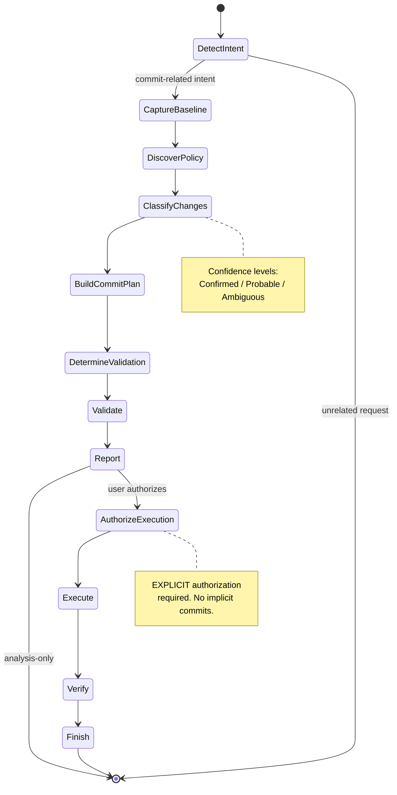

# Conventional Commit Workflow

> A defensive, evidence-based Git commit management agent skill for AI coding assistants.

[](./skills/v2.0.0/system_prompt.md)
[](./tests/)
[](./LICENSE)
[](./mcp_server/)

## 🎯 What is this?

A **system prompt / agent skill** that turns any AI coding assistant (Cursor, Windsurf, VS Code Copilot, Claude
Projects, Custom GPT, or any MCP-compatible agent) into a **specialized Git commit management agent**.

It analyzes your working tree, groups changes into atomic commits, applies Conventional Commits, evaluates
semantic-release impact, validates against repository policy, and executes commits **only when you explicitly authorize
it**.

## ⚡ Why this skill exists

Most AI coding assistants are **too eager** with Git operations. They:

- Run `git add .` and commit unrelated changes.
- Hallucinate repository conventions.
- Confuse "prepare commits" with "execute commits".
- Bypass Git hooks to save time.
- Claim commits succeeded before Git confirms.

This skill was designed with **defensive engineering** as the first principle. Every mutation requires explicit
authorization. Every claim must be backed by evidence. Every repository policy must be discovered, not assumed.

## Architecture

### State Machine



### Operating Modes

| Mode     | Purpose                     | Mutations allowed? |
| -------- | --------------------------- | ------------------ |
| Analyze  | Understand repository state | ❌ No              |
| Prepare  | Construct commit plan       | ❌ No              |
| Validate | Run quality checks          | ⚠️ Only if safe    |
| Execute  | Create authorized commits   | ✅ Yes (scoped)    |

## 🚀 Installation

### Cursor / Windsurf

Copy the contents of [`skills/v2.0.0/system_prompt.md`](./skills/v2.0.0/SKILL.md) into your `.cursorrules` or
`.windsurfrules` file. A pre-adapted version is available at [`.cursorrules`](./.cursorrules).

### VS Code Copilot

Add the skill content to your `.github/copilot-instructions.md` or workspace instructions.

### Claude Projects

Paste the skill content into the Project Instructions.

### Custom GPT

Use the skill content as the GPT's system instructions.

### MCP Server (for agent frameworks)

```bash
cd mcp_server
npm install
npm run build
```

Then configure your MCP client to connect to the server. See [`mcp_server/README.md`](./mcp_server/README.md).

## 📋 Usage Examples

### Analyze changes (read-only)

```
User: Analyze my Git changes before committing.
Agent: [Runs in Analyze mode, produces structured report]
```

### Prepare commits

```
User: Group my changes into atomic commits and suggest messages.
Agent: [Runs in Analyze + Prepare mode, proposes commit plan]
```

### Execute commits (requires authorization)

```
User: Commit the proposed changes.
Agent: [Runs full pipeline, asks for confirmation, executes, verifies]
```

## 🛡️ Safety Guarantees

This skill will **NEVER**, without explicit authorization:

- ❌ Run `git reset --hard`, `git checkout -- .`, or `git restore .`
- ❌ Run `git add .` or `git add -A`
- ❌ Amend, rebase, push, or rewrite history
- ❌ Bypass Git hooks
- ❌ Modify user-owned changes
- ❌ Invent repository policies or validation results
- ❌ Claim commit success before Git confirms

## 🧪 Eval-Driven Development

Every release is validated against automated behavioral tests. See [`tests/`](./tests/) for scenarios including:

- Analysis-only mode respects read-only constraint.
- No hard reset in dangerous repository states.
- Atomic splitting in monorepos.
- Explicit authorization required for execution.

Run locally:

```bash
# PowerShell
./tests/run_evals.ps1

# Bash
./tests/run_evals.sh
```

## 📦 Compatibility

- ✅ Cursor
- ✅ Windsurf
- ✅ VS Code Copilot
- ✅ Claude Projects
- ✅ Custom GPT
- ✅ MCP (Model Context Protocol)
- ✅ Any agent framework supporting system prompts

## 🤝 Contributing

Contributions welcome! Please:

1. Open an issue describing the change.
2. Add a test scenario in `tests/scenarios/`.
3. Update `CHANGELOG.md`.
4. Submit a PR.

## 📄 License

MIT © Alexander Herrera

## 🙏 Acknowledgments

Inspired by the best practices of the Conventional Commits specification, semantic-release, and the defensive
engineering principles of the AI agent safety community.
